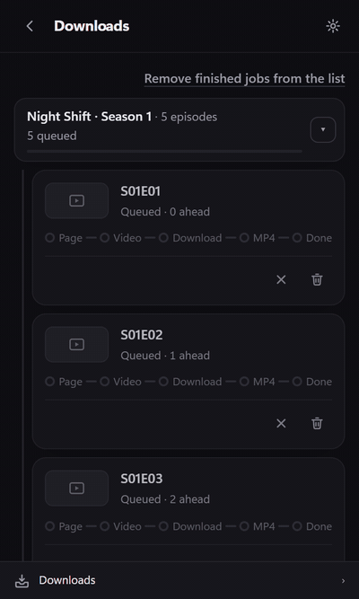
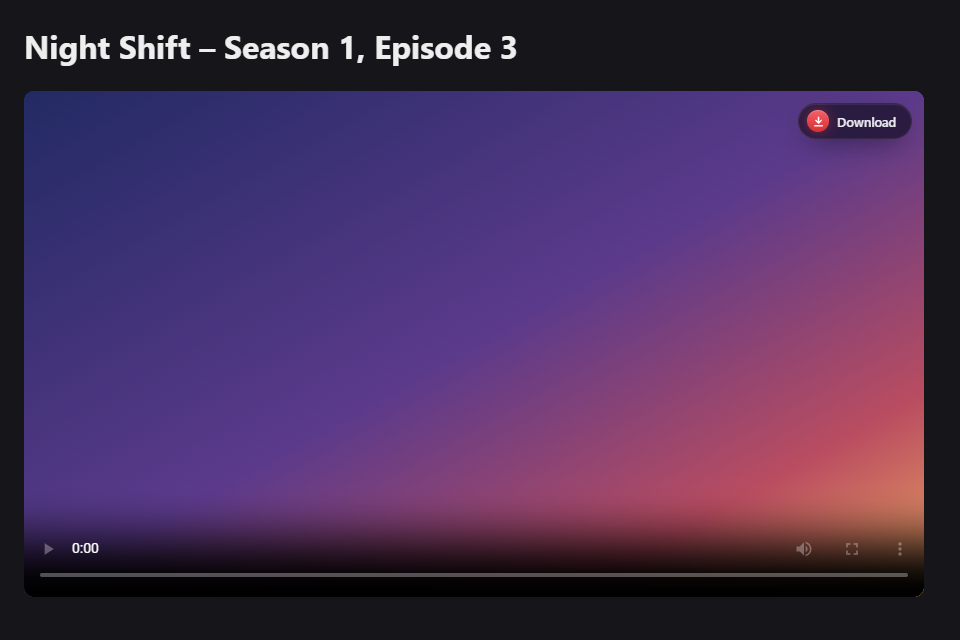
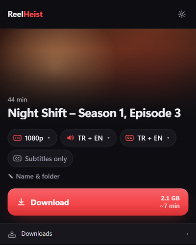
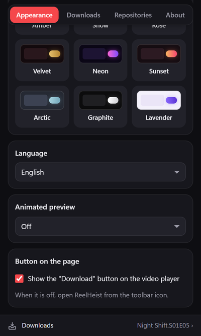
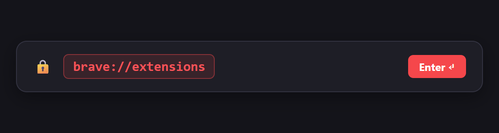
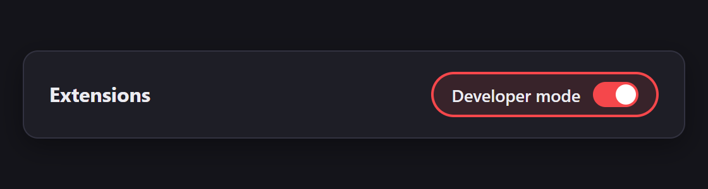
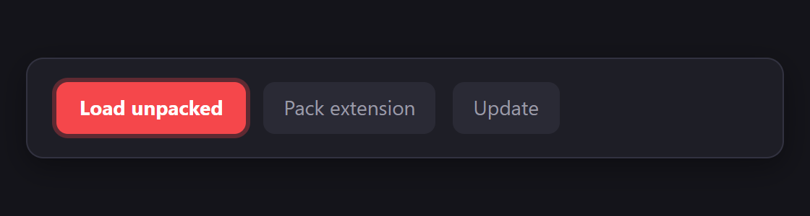

# ReelHeist

[English README](README.md)

**ReelHeist**, tarayıcıdaki HLS akışlarını, doğrudan video bağlantılarını ve YouTube video/oynatma listelerini çoklu ses kanalı ve altyazılarla birlikte temiz `.mp4` dosyaları olarak kaydetmenizi sağlayan yerel bir tarayıcı eklentisi ve Windows yardımcı uygulamasıdır.

  

<table>
  <tr>
    <td align="center" width="50%"> Oynatıcıdaki <b>İndir</b> düğmesi (kapatılabilir)</td>
    <td align="center" width="25%"> Kalite, ses ve altyazı</td>
    <td align="center" width="25%"> 15 tema, 12 dil</td>
  </tr>
</table>

Görsellerdeki arayüz İngilizcedir; eklenti tarayıcı dilinizi kullanır.

---

## 0.3.0 sürümündeki yenilikler

- **Altyazılar MP4 içinde:** altyazılar MP4 içine, oynatıcının menüsünden seçilen izler olarak eklenir. Varsayılan altyazı dillerinden ilki kendiliğinden açılır (VLC'de tercih edilen altyazı dilini ayarlayın). Ayarlar → İndirme → "Altyazıları MP4 içine göm".
- **Her bölüm için klasör:** MP4 ve altyazı dosyaları için bir `srt` klasörü bir arada durur.
- **".srt dosyalarını sakla" ayarı:** kapatırsanız `.srt` dosyaları MP4 içine eklendikten sonra silinir.
- "Bitti" bildirimi, uyarı başka bir konudaysa artık "süreler uyuşmuyor" demiyor.

## 0.2.0 sürümündeki yenilikler

- **Sezon kartları:** bir sezonun her bölümü hemen kart olur ve beş adımlı bir çubuk gösterir. Popup ya da tarayıcı kapansa da kartlar kalır.
- **Bildirimler:** bir bölüm ya da sezon bitince veya bir indirme hata verince Windows bildirimi gelir.
- **Yalnızca altyazı:** bir videonun ya da bütün sezonun yalnızca `.srt` dosyalarını kaydedin.
- **Zorunlu altyazılar** `.<dil>.forced.srt` adıyla kaydedilir; `.tr.srt` her zaman tam altyazıdır.
- **"Sayfadaki düğme" ayarı:** oynatıcıdaki düğmeyi Ayarlar → Görünüm altından kapatın.
- **Sabit "İndirilenler" çubuğu** popup ve panelin altında kalır.
- Sezon araması ve kuyrukta çok sayıda güvenilirlik düzeltmesi.

---

## Özellikler

- **Otomatik video ve altyazı yakalama:** Etkin sekmedeki HLS (`.m3u8`), doğrudan medya dosyaları (`.mp4`, `.webm`, `.mkv`) ve WebVTT/SRT altyazılarını; ayrıca `yt-dlp` aracılığıyla YouTube videolarını ve oynatma listelerini yakalar.
- **Temiz MP4 çıktısı:** `ffmpeg` kullanarak yeniden kodlama (re-encode) yapmadan görüntüyü ve birden çok ses kanalını (dil etiketli, orijinal ses varsayılan olarak işaretli) tek bir standart `.mp4` dosyasında birleştirir.
- **Altyazılar MP4 içinde:** Ayarlar → İndirme → "Altyazıları MP4 içine göm" (varsayılan olarak açık) altyazıları MP4 içine de ekler; oynatıcının altyazı menüsünden seçilir. Varsayılan altyazı dillerinden ilki, MP4 varsayılan işaretini kullanan oynatıcılarda kendiliğinden açılır. VLC'de Araçlar → Tercihler → Altyazılar/OSD → Tercih edilen altyazı dili ayarını yapın.
- **Her bölüm için klasör:** her bölüm dizi klasörünün içinde kendi klasörüne iner (`Dizi\Dizi.S01E02\`). `.srt` dosyaları bunun içindeki `srt` klasörüne konur; Ayarlar → İndirme → ".srt dosyalarını sakla" kapalıysa MP4 içine eklendikten sonra silinir.
- **Duraklat ve sürdür:** İndirilen parçalar diskte korunur; duraklatılan veya kesilen indirmeler kaldığı yerden devam eder.
- **Hareketli önizleme ve seçim çipleri:** 2 saniyelik sessiz önizleme döngüsü, kalite (`1080p`, `720p`, `480p`), ses dili ve altyazı çipleri ile site bazlı seçim belleği sunar.
- **Sezon kartları:** Bir sezonu kuyruğa aldığınızda her bölüm hemen kart olarak görünür; adım çubuğu (Sayfa, Video, İndirme, MP4, Bitti) nerede olduğunu gösterir ve hatalı bölümü yeniden deneyebilirsiniz.
- **Yalnızca altyazı:** "Yalnızca altyazı" çipini açın; video indirilmeden sadece `.srt` dosyaları kaydedilir (bir sezon için de geçerlidir).
- **İndirme bildirimleri:** İndirme bitince veya hata verince Windows bildirimi gösterilir; Ayarlar → İndirme → Bildirimler altından tümü, yalnızca hatalar veya kapalı seçilir.
- **Zorunlu altyazılar ayrı:** yalnızca ekran yazılarını içeren altyazı `.<dil>.forced.srt` adını alır; oynatıcılar varsayılan olarak tam altyazıyı açar.
- **Oynatıcıdaki İndir düğmesi:** sayfadaki video oynatıcının üstünde görünür; Ayarlar → Görünüm → Sayfadaki düğme altından kapatılabilir.
- **15 tema ve 12 dil:** Kırmızı, Siyah/Bej, Gece mavisi, Zümrüt ve on bir tema daha; 12 dilde tam arayüz desteği (`tr`, `en`, `es`, `pt_BR`, `fr`, `de`, `ru`, `ar` sağdan sola, `zh_CN`, `id`, `ja`, `hi`).
- **İmzalı site paketi depoları:** Özel başlık ayrıştırma, bölüm bulma ve oynatıcı başlatma kuralları için Ed25519 imzalı bildirimsel JSON paketleri.

---

## Kurulum (Windows)

1. [GitHub Releases](https://github.com/ergulburak/reelheist/releases) sayfasından **`ReelHeist-Setup-0.3.0.exe`** dosyasını indirip çalıştırın.
   - **Windows SmartScreen uyarısı:** Kurulum programı henüz ücretli bir sertifikayla imzalanmadığı için Windows *"Bilgisayarınız korundu"* uyarısı gösterebilir. **Ek bilgi** → **Yine de çalıştır** seçeneğine tıklayın.
2. Dilinizi seçin ve kurulumu tamamlayın. Yönetici izni gerekmez (`%LOCALAPPDATA%\ReelHeist` altına kurulur).
3. Kurulum sonunda tarayıcınızda **Rehberli Eklenti Kurulum** sayfası otomatik olarak açılır:
   - **1. Adım:** `brave://extensions` (veya `chrome://extensions` / `edge://extensions`) adresini kopyalayıp adres çubuğuna yapıştırın ve Enter'a basın.
     
   - **2. Adım:** Sağ üst köşedeki **Geliştirici modu** anahtarını açın.
     
   - **3. Adım:** **Paketlenmemiş öğe yükle** düğmesine tıklayın ve eklenti klasör yolunu (`%LOCALAPPDATA%\ReelHeist\app\extension`) seçin.
     
   - Eklenti yüklendiğinde rehber sayfası bağlantıyı otomatik algılar ve **Hazır ✓** gösterir.
   - **Geliştirici modu bildirimi:** Tarayıcınız zaman zaman geliştirici modundaki eklentiler için bir hatırlatma gösterebilir; paketlenmemiş eklentiler için bu durum normaldir.

---

## Site Paketi Depoları Ekleme

ReelHeist, standart HTML5/HLS oynatıcılarda ve YouTube'da ek ayar gerektirmeden çalışır. Özel adres kalıpları veya başlık ekleri kullanan siteler için imzalı bir **Site Paketi Deposu** ekleyebilirsiniz:

1. ReelHeist açılır penceresinde **⚙ Ayarlar** düğmesine tıklayın.
2. **Site depoları** bölümüne depo adresini (ör. `https://example.com/repo`) yapıştırıp **Ekle** düğmesine basın.
3. Deponun Ed25519 anahtar parmak izini kontrol edip **Güven** düğmesine tıklayın.
4. Listeden istediğiniz paketleri kurun. Paketler SHA-256 özeti ve Ed25519 imzası doğrulanarak kurulur ve günde bir kez güncellenir.

Paket şeması ve imzalama aracı için [docs/site-packs.md](docs/site-packs.md) belgesine bakın.

---

## Kullanım Sorumluluğu ve Destekçi Notu

- **Haklar ve kişisel kullanım:** ReelHeist yalnızca sahibi olduğunuz, indirme izniniz bulunan veya kişisel çevrimdışı izleme hakkınız olan içerikler için tasarlanmış genel amaçlı bir araçtır. DRM korumalı yayınların şifresini çözmez ve korumaları aşmaz.
- **Destekçi özellikleri (v0.2+ yol haritası):** Gelecekteki destekçi anahtarı mekanizması DRM değil, geliştirmeyi desteklemeye yönelik gönüllü bir teşviktir. Ana kaynak kodu MIT lisansı altında açık kalır.

---

## Üçüncü Taraf Bileşenler

ReelHeist kurulum sırasında aşağıdaki açık kaynaklı bileşenleri kullanır veya indirir:

- **[Node.js](https://nodejs.org/)** (`v22.14.0` taşınabilir çalışma zamanı) — MIT Lisansı
- **[FFmpeg](https://ffmpeg.org/)** ([BtbN/FFmpeg-Builds](https://github.com/BtbN/FFmpeg-Builds) üzerinden indirilir) — GPLv3 Lisansı
- **[yt-dlp](https://github.com/yt-dlp/yt-dlp)** — The Unlicense

---

## Lisans

MIT — ayrıntılar için [LICENSE](LICENSE) dosyasına bakın.
